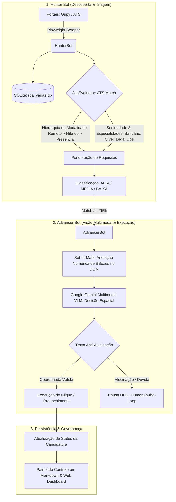

# 🤖 RPA & AI Job Hunter — Autonomous Legal & Tech Career Pipeline

[](https://www.python.org/)
[](https://playwright.dev/)
[](https://ai.google.dev/)
[](https://opensource.org/licenses/MIT)

Sistema autônomo e bimodal de mineração de vagas, cálculo de aderência ATS (Applicant Tracking System), preenchimento automatizado de formulários via visão computacional multimodal (VLM + Set-of-Mark) e geração executiva de cartas de apresentação.

---

## 🏛️ 1. Arquitetura Bimodal (Hunter + Advancer)

O ecossistema é projetado sob a separação estrita de responsabilidades em dois motores colaborativos:



---

## 💎 2. Destaques Técnicos & Inovação

1. **Visual Grounding via Set-of-Mark (SoM):**
   - O motor injeta dinamicamente um script JavaScript (`engine/vision/set_of_mark.js`) que demarca numericamente cada elemento interativo do DOM com caixas delimitadoras coloridas (bounding boxes). O modelo de visão computacional (VLM) recebe a imagem rotulada e indica exatamente o identificador do elemento a ser acionado, eliminando dependência frágil de seletores XPath/CSS que quebram com atualizações de layout.
2. **Triagem Ponderada de Perfil (ATS Match Scoring):**
   - Cálculo determinístico de aderência baseado no dossiê canônico (`candidate_profile.json`), priorizando modalidades flexíveis (Home Office / Híbrido), senioridade e especialidades centrais.
3. **Mecanismo Anti-Alucinação & Fail-Closed:**
   - Caso o motor VLM tente selecionar um ID inexistente ou se depare com questionários eliminatórios exclusivos da empresa sem correspondência no dossiê oficial, a automação entra em pausa imediata (`wait`), solicitando validação humana via canal autenticado.
4. **Cache Determinístico de Questionários:**
   - Hash SHA-256 de perguntas e respostas gravadas no SQLite para consumo zero de tokens em perguntas repetidas de recrutamento.
5. **Dashboard Web com Live Streaming:**
   - Interface web leve (`web_dashboard.py`) para monitoramento em tempo real do progresso das candidaturas e visualização de capturas de tela das etapas.

---

## 🚀 3. Guia de Instalação e Execução

### 3.1. Pré-requisitos
- Python 3.11+
- Google Chrome ou Chromium com suporte a Playwright

### 3.2. Instalação
```bash
# 1. Clonar o repositório
git clone https://github.com/funil66/RPA-VAGAS.git
cd RPA-VAGAS

# 2. Criar ambiente virtual e instalar dependências
python3 -m venv .venv
source .venv/bin/activate
pip install -r requirements.txt
playwright install chromium
```

### 3.3. Configuração de Variáveis de Ambiente
Copie o arquivo de exemplo e configure suas chaves:
```bash
cp .env.example .env
```

Parâmetros essenciais no `.env`:
```ini
# Chave da API do Google Gemini (para o motor multimodal VLM)
GEMINI_API_KEY="sua_chave_gemini_aqui"

# Notificações via Bot Telegram (opcional)
TELEGRAM_BOT_TOKEN="seu_token_telegram_aqui"
TELEGRAM_CHAT_ID="seu_chat_id_aqui"

# Caminho do Currículo PDF
LOCAL_CV_PATH="data/curriculo_exemplo.pdf"
```

---

## 🛠️ 4. Comandos da Interface CLI

```bash
# Varredura de vagas com termos específicos
python cli.py search --terms "Advogado Sênior, Contencioso Cível, Legal Ops" --limit 15

# Listagem filtrada por nota de corte de Match Score
python cli.py list --min-score 75

# Filtrar oportunidades 100% remotas
python cli.py list --mode REMOTE

# Visualizar resumo analítico e métricas do pipeline
python cli.py stats

# Pré-visualizar carta de apresentação personalizada para uma vaga
python cli.py letter --id 1

# Executar o motor de avanço autônomo (Gupy Service)
python gupy_service.py run --headless

# Iniciar o painel web de monitoramento
python web_dashboard.py --port 8888
```

---

## 🧪 5. Testes Automatizados

A suíte de testes unitários e de integração cobre a avaliação de aderência, os robôs bimodais, o crawler de etapas e a persistência em banco:

```bash
pytest tests/ -v
```

Resultado da validação contínua:
```text
tests/test_bimodal_bots.py ........                      [ 29%]
tests/test_cognitive_solver.py ....                     [ 44%]
tests/test_crawler.py .                                 [ 48%]
tests/test_evaluator.py ...                             [ 59%]
tests/test_repository.py ...                            [ 70%]
tests/test_session_manager.py .....                     [ 88%]
tests/test_tier1_agent.py ...                           [100%]

======================== 27 passed in 0.32s ========================
```

---

## 📄 Licença

Distribuído sob a licença MIT. Consulte `LICENSE` para obter mais detalhes.
