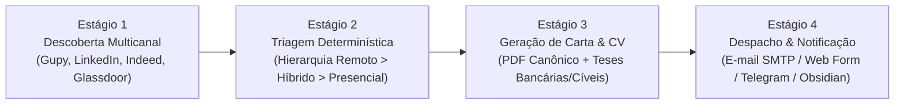

# 📋 ESTEIRA DE VAGAS JURÍDICAS & CARREIRA — PROCEDIMENTO OPERACIONAL PADRÃO (SOP)
**Advocacia Profissional Jurídico Sênior — OAB/SP 000.000**  
**Código:** SOP-ADV-05-VAGAS | **Versão:** 1.0 | **Data:** 01/09/2026

---

## 🎯 1. OBJETIVO
Definir o procedimento operacional padrão para a execução autônoma, supervisão humana (human-in-the-loop) e governança da esteira de captação de vagas jurídicas e envio de candidaturas para o Candidato Modelo.

---

## 🔄 2. OS 4 ESTÁGIOS DA ESTEIRA

### 📌 Estágio 1: Descoberta Multicanal
- **Frequência:** A cada 60 minutos (via `rpa-vagas.service` na VPS) ou sob demanda via CLI.
- **Fontes:**
  - `Gupy Portal`: Scraping via Playwright Headless.
  - `Indeed Brasil`, `LinkedIn Jobs`, `Glassdoor`: Scraping via `python-jobspy`.
- **Deduplicação:** Hash MD5 único por `plataforma + external_id` garantindo idempotência no banco SQLite.

### 📌 Estágio 2: Triagem & Matching Determinístico
- **Entrada:** Vagas com status `DISCOVERED`.
- **Regras:**
  - Aplicação do algoritmo de scoring (0 a 100%).
  - Ponderação estrita: **1º Remoto (+35)** ➔ **2º Híbrido (+20)** ➔ **3º Presencial (+10 em SP / -15 fora)**.
  - Reconhecimento de competências-chave (Bancário, Cível, Fraudes PIX, Legal Ops).
- **Saída:** Transição para status `EVALUATED` com atribuição de prioridade (`ALTA`, `MEDIA`, `BAIXA`).

### 📌 Estágio 3: Elaboração da Candidatura & Carta de Apresentação
- **Gatilho:** Match Score $\ge 75\%$.
- **Ações:**
  - Extração de contatos de RH / e-mail da vaga.
  - Geração da carta de apresentação personalizada e persuasiva com dados do Candidato (OAB/SP 000.000).
  - Vinculação do arquivo canônico de currículo em PDF (`Curriculo Candidato Modelo.pdf`).

### 📌 Estágio 4: Despacho, Notificação e Observabilidade
- **Ações de Despacho:**
  - **Via E-mail:** Envio via SMTP autenticado com a carta no corpo e o PDF anexo.
  - **Via Formulário Web:** Preenchimento automatizado dos campos (Nome, Telefone, LinkedIn, OAB, Upload do CV).
- **Notificação:** Alerta instantâneo no Telegram (`@IronCode99_bot`) com dados da vaga, score e link direto.
- **Sincronização:** Atualização automática do painel no Obsidian:
  `ObsidianVault/PROFISSIONAL/BUSCA_DE_EMPREGO_E_VAGAS/PAINEL_VAGAS_EMPREGO.md`.

---

## 🛠️ 3. MATRIZ DE AÇÕES OPERACIONAIS

| Cenário | Ação Recomendada | Comando |
| :--- | :--- | :--- |
| **Nova vaga remota com score $\ge 80\%$ detectada** | Notificação no Telegram e candidatura autônoma disparada. | Automático (Daemon VPS) |
| **Revisar lista de oportunidades da semana** | Consultar painel no Obsidian ou listar via CLI. | `python3 cli.py list --min-score 70` |
| **Simular envio de candidatura sem disparar e-mail real** | Executar o comando `apply` em modo dry-run. | `python3 cli.py apply --min-score 75` |
| **Forçar varredura manual de emergência** | Executar busca sob demanda. | `python3 cli.py search --terms "Advogado Bancário"` |
| **Verificar saúde do serviço na VPS** | Consultar status no terminal da VPS. | `systemctl status rpa-vagas.service` |

---

## 🔒 4. CONTROLE DE QUALIDADE & INCIDENTES
1. **Falha de Conectividade de Scraper:** O sistema registra o erro em log (`data/rpa_vagas.log`), ignora a fonte com falha momentânea e conclui a varredura nas demais plataformas sem travar a esteira.
2. **Atualização de Currículo:** Ao atualizar o arquivo `Curriculo Candidato Modelo.pdf`, basta substituir o arquivo no diretório `data/` e no Obsidian Vault para que as novas candidaturas utilizem a versão atualizada.
