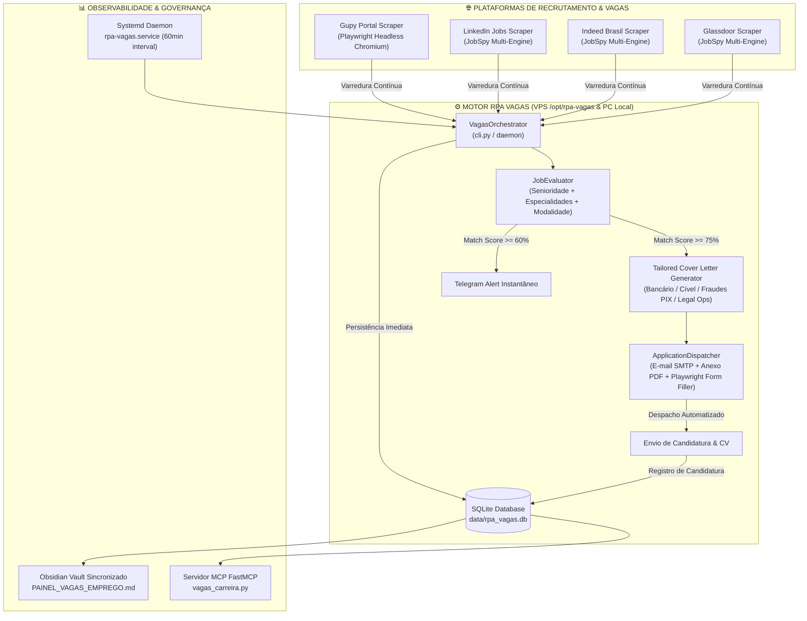

# 🏛️ MANUAL CANÔNICO: ROBÔ RPA DE BUSCA DE VAGAS, MATCHING & CANDIDATURAS JURÍDICAS
**Advocacia Profissional Jurídico Sênior — OAB/SP 000.000**  
**Versão:** 1.0 (Canônica Definitiva) | **Data:** 01 de Setembro de 2026  
**Repositório Dedicado GitHub:** `https://github.com/funil66/RPA-VAGAS` (Privado)  
**Ambiente de Execução:** VPS Contabo (`vps.servidor.exemplo`) + PC Local Worker  
**Serviço em Segundo Plano:** `systemd / rpa-vagas.service` (24/7 Autônomo)  
**Status:** 🟢 Operacional & Homologado

---

## 🎯 1. DIRETRIZES ESTRATÉGICAS E REGRAS DE NEGÓCIO

> [!IMPORTANT]
> **CAMINHO DETERMINÍSTICO E PREFERÊNCIA ESTREITA DE MODALIDADE**  
> Todo o pipeline de captação de oportunidades, triagem por inteligência artificial e despacho de candidaturas opera sob uma régua determinística imutável:
>
> 1. **1ª Prioridade (Score Máximo / Boost +35pts):** Home Office / 100% Remoto (`REMOTE`).
> 2. **2ª Prioridade (Score Intermediário / Boost +20pts):** Modelo Híbrido (`HYBRID`).
> 3. **3ª Prioridade (Score Condicional / Boost +10pts ou -15pts):** Presencial (`PRESENTIAL`) — apenas se localizado na região de São Paulo capital e região. Presenciais fora do domicílio sofrem penalidade no score.

---

## 🏗️ 2. ARQUITETURA MULTICANAL E FLUXO DE DADOS



---

## 💎 3. PERFIL CANÔNICO DO CANDIDATO

O motor cruza os requisitos das vagas com as credenciais canônicas do Candidato Modelo:

- **Nome Completo:** Profissional Jurídico Sênior
- **Inscrição:** OAB/SP 000.000
- **Contato:** `+55 (16) 9****-****` | `contato@exemplo.com`
- **LinkedIn:** `https://www.linkedin.com/in/exemplo/`
- **Arquivo de Currículo Canônico:** `curriculo_exemplo.pdf` (configurado via `LOCAL_CV_PATH`)
- **Senioridade & Expertise:**
  - **Contencioso Cível e Bancário Massivo e Estratégico:** Sólida atuação na defesa de instituições financeiras (Instituição Financeira Modelo, Banco Instituição Financeira Modelo, entre outros).
  - **Fraudes Digitais & Segurança Bancária:** Teses avançadas e jurisprudência consolidada em golpes do PIX, clonagem de contas, invasão de aplicativos bancários e engenharia social.
  - **Superendividamento:** Aplicação especializada da Lei 14.181/2021 (repactuação de dívidas, preservação do mínimo existencial).
  - **Legal Ops & Jurimetria:** Controle e saneamento de carteiras volumosas, gestão de prazos fatais, parametrização de ERPs líderes de mercado (*LEGALE, ELAW, ProJuris, CPJ, TEDESCO*).

---

## 🧮 4. ALGORITMO DE MATCHING & SCORING DETERMINÍSTICO

O cálculo do **Match Score (0 a 100%)** segue fórmula ponderada:

$$ \text{Score Total} = \text{Score Modalidade} + \text{Score Senioridade} + \text{Score Especialidade} $$

### 4.1. Modalidade de Trabalho (Até 35 pontos)
- **100% Home Office / Remoto:** `+35 pontos`
- **Híbrido:** `+20 pontos`
- **Presencial (Região SP / São Paulo):** `+10 pontos`
- **Presencial (Fora do Domicílio Principal):** `-15 pontos`

### 4.2. Senioridade e Nível do Cargo (Até 25 pontos)
- **Sênior / Especialista / Coordenador / Head / Consultor:** `+25 pontos`
- **Pleno / Advogado Geral / Associado:** `+20 pontos`
- **Estágio / Assistente Administrativo:** `-30 pontos`

### 4.3. Especialidades Jurídicas (Até 40 pontos cumulativos)
- **Bancário / Instituições Financeiras:** `+15 pontos`
- **Contencioso Cível / Massivo / Estratégico:** `+15 pontos`
- **Fraudes Digitais / PIX / Golpes Virtuais:** `+15 pontos`
- **Legal Ops / Controladoria Jurídica / Jurimetria:** `+10 pontos`
- **Trabalhista / Defesas Corporativas:** `+10 pontos`
- **Contratos / Direito Comercial:** `+10 pontos`

### 4.4. Classificação de Prioridade:
- **ALTA:** Score $\ge 75\%$ ➔ Disparo imediato de candidatura e alerta prioritário no Telegram.
- **MÉDIA:** $50\% \le \text{Score} < 75\%$ ➔ Inclusão no painel Obsidian e monitoramento.
- **BAIXA:** Score $< 50\%$ ➔ Descartada ou arquivada.

---

## ✉️ 5. MOTOR DE CARTAS DE APRESENTAÇÃO HIPER-PERSONALIZADAS

O gerador dinâmico identifica a ênfase da vaga e formula a carta de apresentação automaticamente.

### Exemplo de Carta Gerada (Vaga Bancária / Fraudes):
```markdown
Prezados(as) recrutadores da [Nome da Empresa / Escritório],

Apresento minha candidatura à oportunidade de **Advogado Contencioso Cível - Bancário**.

Sou **Candidato Jurídico** (OAB/SP 000.000), graduado em Direito com formação complementar em Serviços Jurídicos e inglês avançado.

Com sólida bagagem no contencioso massivo e estratégico bancário — tendo atuado em bancas de grande porte na defesa de instituições como Instituição Financeira Modelo e Banco Instituição Financeira Modelo —, possuo profundo domínio técnico em teses defensivas de fraudes digitais (golpes do PIX, engenharia social), ações de superendividamento (Lei 14.181/2021) e jurimetria aplicada para redução de contingências.

Estou plenamente alinhado com a dinâmica de atuação da vaga e coloco à disposição minha capacidade analítica, rigor ético e foco em resultados mensuráveis para agregar valor imediato à equipe.

Em anexo, encaminho meu currículo detalhado. Agradeço a atenção e permaneço à disposição para entrevista.

Cordialmente,

**Candidato Jurídico**
Advogado | OAB/SP 000.000
📞 +55 (16) 9****-****
✉️ contato@exemplo.com
🔗 https://www.linkedin.com/in/exemplo/
```

---

## 🖥️ 6. DEPLOY & OPERAÇÃO NA VPS (`vps.servidor.exemplo`)

### 6.1. Localização e Ambiente
- **Diretório Raiz na VPS:** `/opt/rpa-vagas`
- **Virtualenv:** `/opt/rpa-vagas/.venv`
- **Navegador Headless:** Playwright Chromium (`/root/.cache/ms-playwright`)

### 6.2. Gerenciamento do Serviço Systemd
```bash
# Verificar status do serviço
systemctl status rpa-vagas.service

# Acompanhar logs em tempo real
journalctl -u rpa-vagas.service -f -n 50

# Reiniciar serviço
systemctl restart rpa-vagas.service

# Parar serviço temporariamente
systemctl stop rpa-vagas.service
```

---

## 💻 7. COMANDOS OPERACIONAIS DA CLI

```bash
# 1. Executar varredura em todas as plataformas
python3 cli.py search --terms "Advogado Sênior, Advogado Bancário, Advogado Legal Ops" --limit 15

# 2. Listar oportunidades mapeadas com filtros
python3 cli.py list --min-score 70 --mode REMOTE

# 3. Exibir estatísticas consolidadas do banco SQLite
python3 cli.py stats

# 4. Gerar carta de apresentação personalizada para vaga específica
python3 cli.py letter --id 16

# 5. Executar envio de candidaturas (Modo Dry-Run / Simulação segura)
python3 cli.py apply --min-score 75

# 6. Executar envio de candidaturas em Produção Real
python3 cli.py apply --min-score 75 --prod

# 7. Sincronizar painel no Obsidian
python3 cli.py sync-vault

# 8. Executar suíte de testes unitários
pytest tests/ -v
```

---

## 🔗 8. INTEGRAÇÕES & RECURSOS EXTERNOS
- **Painel Central Obsidian:** `ObsidianVault/PROFISSIONAL/BUSCA_DE_EMPREGO_E_VAGAS/PAINEL_VAGAS_EMPREGO.md`
- **GitHub Oficial:** `https://github.com/funil66/RPA-VAGAS`
- **MCP Server:** `01_ADVOCACIA/02_Agentes_MCP/vagas_carreira.py`
- **Telegram Bot Notifier:** Bot `@IronCode99_bot` / Notificações em canal privado.
